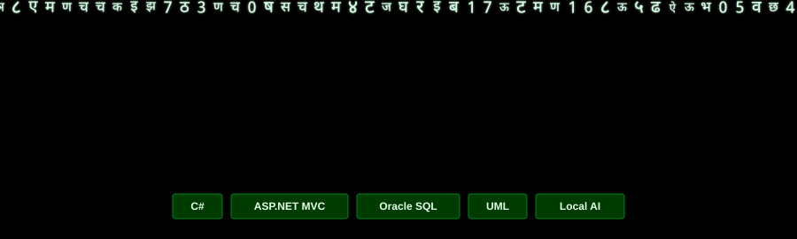

Apresentação
Gilberto Ambrosio G. M. Neto atua com sistemas corporativos, consultas e relatórios em Oracle Database e manutenção de aplicações. Seu trabalho envolve C#, ASP.NET MVC e SQL, com atenção ao fluxo dos dados, às regras de negócio e à preservação do comportamento dos sistemas existentes.

Seu perfil técnico é marcado pela investigação do funcionamento das aplicações: rastreamento de relacionamentos, análise de responsabilidades e depuração para compreender a origem dos resultados. Valoriza explicações fundamentadas, documentação das decisões e verificação das alterações.
Experiência com sistemas e desenvolvimento
Atua em atividades relacionadas à manutenção e evolução de sistemas corporativos, com contato com aplicações em C#, ASP.NET MVC, PHP e Oracle Database. Trabalha na investigação de consultas SQL, relacionamentos entre tabelas, regras de negócio e fluxo de informações, além de analisar problemas em ambientes de desenvolvimento e homologação.

Também tem contato com aplicações legadas e infraestrutura de execução, incluindo serviços Apache/PHP e IIS. Em tarefas de manutenção, procura compreender o comportamento existente antes de alterar código, validar o efeito das mudanças e evitar regressões.

Sua experiência profissional inclui ainda operações de comércio eletrônico e integração de ferramentas de gestão, com atividades envolvendo ERP Bling, plataforma Tray, marketplaces, pedidos, preços, campanhas, notas fiscais, etiquetas, estoque, meios de pagamento e atendimento ao cliente. Essa vivência aproxima a análise técnica dos processos operacionais que os sistemas precisam atender.
Desenvolvimento e aprendizagem
Cursa Sistemas de Informação na UNIP, com previsão de conclusão em 2027. Aprofunda conhecimentos em arquitetura MVC, modelagem UML, banco de dados, desenvolvimento de software e infraestrutura por meio de projetos com implementação manual, diagramas e acompanhamento da execução passo a passo.

Organiza a aprendizagem em Contexto → Tarefa → Ação → Verificação, utilizando a IA como apoio à compreensão da lógica, ao planejamento e à revisão técnica. Prefere investigar a causa dos problemas, entender as responsabilidades de cada componente e validar o resultado, em vez de apenas aplicar soluções prontas.

Entre os projetos de estudo estão um player de áudio e um gerador de fractais geométricos, planejados para exercitar modelagem, separação de responsabilidades e implementação.
Projetos e experimentos
- CLICompressor: ferramenta de linha de comando para compressão de imagens em lote, pensada para simplificar uma tarefa operacional recorrente sem depender de serviços online com anúncios ou limitações. O projeto também envolve atenção à experiência de uso e à identidade visual.
- APIs em Python: experimentos com uma API HTTP integrada a serviços externos de meteorologia, organizada em endpoints para condições atuais, previsão, qualidade do ar, dados marítimos e busca de localidades. O trabalho inclui validação de parâmetros, tratamento de respostas e testes.
- Filas de processamento: projeto experimental de uma API de jobs com Python, SQLite e worker, utilizado para estudar processamento assíncrono, concorrência, cancelamento, paginação e identificação de falhas comportamentais.
- Ollama Runtime Inspector: conceito de ferramenta desktop em Python e PySide6 para acompanhar a execução de modelos locais, interpretar logs, observar métricas de CPU/GPU e memória e organizar eventos de carregamento e geração.
- Ambientes 3D com Three.js: experimentos com mundos e cidades gerados no navegador, explorando distribuição procedural de construções, vegetação, bairros e diferentes ambientes urbanos, além da possibilidade de integração com modelos de linguagem.
- Plataforma de estudos com IA local: planejamento de um ambiente que utiliza Obsidian como base de conhecimento e modelos locais para consultar materiais acadêmicos, organizar notas e apoiar o estudo preservando a fidelidade aos documentos de origem.
Esses projetos representam diferentes estágios de estudo, experimentação e planejamento; não são apresentados como produtos necessariamente concluídos ou publicados.
Inteligência artificial e infraestrutura local
Mantém interesse em LLMs locais e sistemas de agentes, com experimentos em Ollama, modelos quantizados e interfaces compatíveis com APIs. Investiga execução em GPU, consumo de VRAM e memória, tamanho de contexto, cache KV, desempenho de geração e limitações impostas pelo hardware disponível.

Também explora ferramentas de desenvolvimento assistido por agentes, como Pi e OpenCode, e a integração de modelos com ferramentas externas. Seus estudos incluem gestão de contexto, memória persistente, compactação de sessões, recuperação de informações e mecanismos de execução e verificação.

Parte dessa investigação envolve disponibilizar serviços de inferência na rede local e acessar o ambiente remotamente, incluindo experiências com Linux, Windows, SSH e Tailscale. O foco não está apenas em executar um modelo, mas em compreender a infraestrutura necessária para construir um fluxo de desenvolvimento local, observável e confiável.
Outros temas técnicos
Além do desenvolvimento de aplicações, estuda e experimenta assuntos relacionados a:
- Banco de dados: consultas SQL, relacionamentos, validação de dados e análise de estruturas Oracle.
- Infraestrutura e sistemas: Linux, Windows, Apache, IIS, serviços de rede, acesso remoto e configuração de ambientes.
- Engenharia de software: arquitetura MVC, UML, organização de projetos, testes, depuração, documentação e controle de versão com Git.
- Segurança da informação: fundamentos de cibersegurança, análise técnica e compreensão de vulnerabilidades e ferramentas.
- Computação gráfica e jogos: Three.js, geração procedural de ambientes e investigação de projetos de preservação e execução de jogos em plataformas alternativas.
Atividades acadêmicas e colaboração
Participou da organização e apresentação de uma atividade em grupo sobre cibersegurança, negócios e comunidade, conduzindo uma exposição com dez participantes. Também colaborou na produção de um e-book acadêmico sobre virtualização, abordando tecnologias e plataformas como VMware, VirtualBox, Hyper-V e QEMU.

Essas atividades complementam a formação técnica com pesquisa, organização de conteúdo, documentação e comunicação de assuntos relacionados à tecnologia.
Esta apresentação foi elaborada a partir de informações compartilhadas em conversas sobre trabalho, estudos, projetos e experimentos técnicos. As atividades são descritas conforme o contexto disponível e distinguem experiências profissionais de iniciativas acadêmicas, estudos, protótipos e planos em desenvolvimento.
